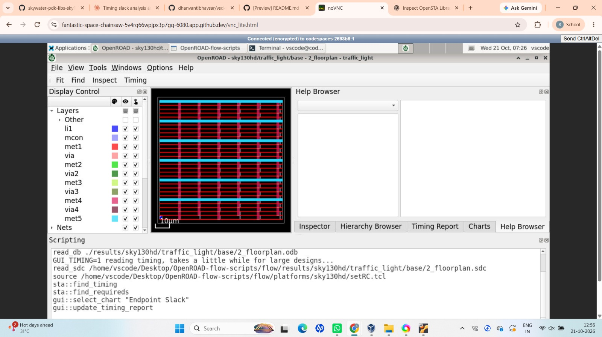
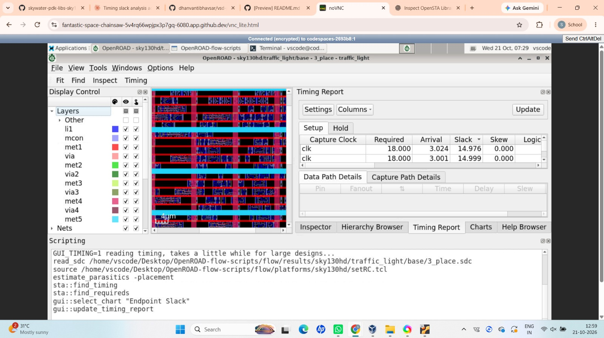
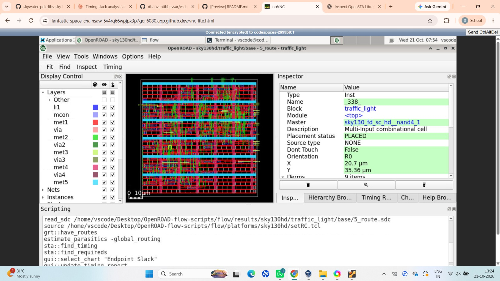

# 🚦 FSM-Based Traffic Light Controller with Countdown Timer

<p align="center">
  
  
  
  
  
</p>

<p align="center">
  <b>A Complete RTL-to-Physical-Design VLSI Project</b><br/>
  <i>From Verilog RTL design and functional verification to physical implementation and post-layout timing analysis.</i>
</p>

---

## About the Project

The **FSM-Based Traffic Light Controller with Countdown Timer** is a digital design project implemented using Verilog HDL.

I developed this project to explore the complete digital IC design flow, starting from RTL design and functional verification and progressing toward gate-level implementation, physical design, and post-layout Static Timing Analysis (STA).

The controller uses a Finite State Machine (FSM) to manage the traffic-light sequence and a countdown mechanism to represent the remaining duration of each state.

Using the SKY130HD standard-cell library and open-source VLSI tools, I explored how synthesizable RTL is transformed into a physically implemented circuit.

This repository documents each stage of my project, including source code, testbenches, simulation waveforms, synthesis reports, physical-design visualizations, timing reports, and video documentation.

## Project Objectives

- Design an FSM-based traffic-light controller using Verilog HDL.
- Implement countdown functionality for traffic-light state durations.
- Verify the RTL using a simulation testbench.
- Synthesize the design into a gate-level netlist.
- Perform gate-level simulation and inspect waveform results.
- Understand timing constraints and setup/hold analysis.
- Implement the design using the OpenROAD physical-design flow.
- Analyze post-layout timing across 16 PVT corners.
- Document the complete workflow with reports, screenshots, and video documentation.

## Project Architecture

The controller uses sequential logic to manage traffic-light states and countdown behavior.

### Main Functional Blocks

| Block | Description |
|---|---|
| Finite State Machine | Controls the sequence of traffic-light states |
| Countdown Timer | Tracks the remaining duration of the current state |
| Clock | Synchronizes sequential operations |
| Reset | Initializes the controller to its starting condition |
| Traffic-Light Outputs | Indicate the active red, yellow, and green states |
| Countdown Outputs | Represent the remaining count and associated display outputs |

## Complete Project Roadmap

Click any stage number or title to explore its folder and documentation.

| Stage | Project Phase | What I Explored |
|:---:|---|---|
| [**00**](00_Project_Introduction_and_Specifications/) | [Project Introduction and Specifications](00_Project_Introduction_and_Specifications/) | Project concept, problem statement, and design specifications |
| [**01**](01_RTL_Design_and_Testbench/) | [RTL Design and Testbench](01_RTL_Design_and_Testbench/) | Verilog implementation, FSM, countdown logic, and RTL simulation |
| [**02**](02_RTL_Synthesis/) | [RTL Synthesis](02_RTL_Synthesis/) | Logic synthesis, technology mapping, netlist, and cell statistics |
| [**03**](03_Gate_Level_Simulation/) | [Gate-Level Simulation](03_Gate_Level_Simulation/) | Gate-level verification and waveform analysis |
| [**04**](04_Static_Timing_Analysis/) | [Static Timing Analysis](04_Static_Timing_Analysis/) | Timing constraints, timing paths, and setup/hold analysis |
| [**05**](05_Physical_Design/) | [Physical Design Using OpenROAD](05_Physical_Design/) | Floorplanning, placement, CTS, routing, and final implementation |
| [**06**](06_Post_Layout_STA/) | [Post-Layout Static Timing Analysis](06_Post_Layout_STA/) | Extracted parasitics, timing reports, and 16-corner PVT analysis |

---

## Stage-by-Stage Exploration

### 00 — Project Introduction and Specifications

[📂 Explore Stage 00](00_Project_Introduction_and_Specifications/)

This stage introduces the traffic-light controller, its purpose, and the design requirements. I documented the project concept and specifications before moving into RTL development.

### 01 — RTL Design and Testbench

[📂 Explore Stage 01](01_RTL_Design_and_Testbench/)

I implemented the traffic-light controller in Verilog HDL and developed a testbench to verify its sequential behavior.

The design includes FSM-based state transitions, countdown functionality, reset behavior, and traffic-light outputs.

### 02 — RTL Synthesis

[📂 Explore Stage 02](02_RTL_Synthesis/)

I explored synthesis using Yosys and the SKY130HD standard-cell library.

This stage documents the synthesized netlist, technology mapping, cell statistics, and synthesis reports.

### 03 — Gate-Level Simulation

[📂 Explore Stage 03](03_Gate_Level_Simulation/)

After synthesis, I explored gate-level simulation to verify the synthesized design's behavior.

I examined simulation waveforms and compared RTL and gate-level behavior to understand the relationship between behavioral logic and its gate-level implementation.

### 04 — Static Timing Analysis

[📂 Explore Stage 04](04_Static_Timing_Analysis/)

I explored static timing analysis to understand timing constraints, critical paths, setup requirements, and hold requirements.

This stage connects the synthesized design with timing analysis used to evaluate circuit behavior under defined constraints.

### 05 — Physical Design Using OpenROAD

[📂 Explore Stage 05](05_Physical_Design/)

I used the OpenROAD flow with the SKY130HD platform to explore physical implementation.

The documented stages include:

- Floorplanning and power-distribution preparation
- Global and detailed placement
- Placement optimization
- Clock Tree Synthesis (CTS)
- Global and detailed routing
- Final implementation and report inspection

#### Physical-Design Visualizations

Add or retain the screenshots in your physical-design folder and link them below if the filenames match your uploaded images.

<p align="center">
  <b>Floorplan</b><br/>
  
</p>

<p align="center">
  <b>Placement</b><br/>
  
</p>

<p align="center">
  <b>Routing</b><br/>
  
</p>

[📂 Explore all Physical-Design Reports and Screenshots](05_Physical_Design/)

### 06 — Post-Layout Static Timing Analysis

[📂 Explore Stage 06](06_Post_Layout_STA/)

I performed post-route STA using the final OpenROAD database and extracted interconnect parasitics.

This stage includes:

- Setup and hold timing reports
- Worst Negative Slack (WNS)
- Total Negative Slack (TNS)
- Timing analysis across 16 PVT corners
- Timing-result visualizations and summary reports

#### Key Timing Results

| Parameter | Result |
|---|---:|
| Clock period | 20 ns |
| PVT corners analyzed | 16 |
| Typical corner | `tt_025C_1v80` |
| Typical-corner worst setup slack | 14.64 ns |
| Typical-corner worst hold slack | 0.50 ns |
| Critical setup corner | `ss_n40C_1v28` |
| Critical-corner setup slack | -6.33 ns |
| Critical-corner TNS | -52.66 ns |

**Timing note:** The typical-corner results are positive, but `ss_n40C_1v28` exhibits a setup timing violation. Therefore, the design should not be described as meeting setup timing across all 16 analyzed corners.

---

## 🎥 Video Documentation

My video documentation complements this repository by demonstrating the project workflow, tools, and implementation results.

The walkthrough can cover:

- Project introduction and RTL design
- Testbench execution and simulation waveforms
- RTL synthesis and gate-level simulation
- OpenROAD physical-design stages
- Post-layout STA and PVT-corner results
- Key observations and project learnings

**▶️ Project Demonstration Video:** [Add your video link here](https://www.youtube.com/)

> Replace the example link with your actual uploaded video URL before publishing. If your video is hosted on Google Drive, use its shareable link instead.

---

## Tools and Technologies

| Tool / Technology | Application |
|---|---|
| Verilog HDL | RTL design |
| Icarus Verilog | RTL and gate-level simulation |
| GTKWave | Waveform visualization |
| Yosys | Logic synthesis and technology mapping |
| SKY130HD | Standard-cell library |
| OpenROAD Flow Scripts | Physical-design implementation |
| OpenSTA | Static timing analysis |
| Liberty (`.lib`) | Standard-cell timing models |
| SDC (`.sdc`) | Timing constraints |
| SPEF (`.spef`) | Extracted interconnect parasitics |
| ODB (`.odb`) | Physical-design database |
| DEF (`.def`) | Physical-design layout representation |
| GitHub | Version control and project documentation |

## 📁 Repository Structure

```text
FSM-Traffic-Light-Controller/
│
├── README.md
│
├── 00_Project_Introduction_and_Specifications/
│   └── README.md
│
├── 01_RTL_Design_and_Testbench/
│   └── README.md
│
├── 02_RTL_Synthesis/
│   └── README.md
│
├── 03_Gate_Level_Simulation/
│   └── README.md
│
├── 04_Static_Timing_Analysis/
│   ├── README.md
│   └── reports/
│
├── 05_Physical_Design/
│   ├── README.md
│   ├── reports/
│   └── final_outputs_traffic light/
│
└── 06_Post_Layout_STA/
    ├── README.md
    ├── reports/
    └── scripts/
```

Each stage folder contains its own documentation and supporting artifacts. Additional source files, reports, waveforms, and screenshots are stored within the respective directories.

## Key Learnings

Through this project, I explored the progression from RTL design to physical implementation and developed an understanding of:

- FSM-based sequential digital design
- RTL verification and testbench development
- Logic synthesis and technology mapping
- Gate-level simulation and waveform analysis
- Static timing analysis and timing constraints
- Floorplanning, placement, CTS, and routing
- Extracted parasitics and post-route timing
- PVT-corner analysis and critical timing conditions
- Technical documentation using GitHub

## Project Summary

This project brought together important stages of digital IC design, from Verilog RTL development to physical implementation and post-layout timing analysis.

By documenting each stage separately, I created a structured record of my learning process, design artifacts, simulation results, implementation visualizations, and timing reports.

This repository represents my practical exploration of an open-source VLSI design flow using Verilog, Yosys, SKY130HD, OpenROAD, and OpenSTA.

---

<p align="center">
  <b>Designed and Documented by Shaik Farida</b><br/>
  VLSI Design | RTL-to-Physical Design | OpenROAD | OpenSTA
</p>

<p align="center">
  <i>"Every stage of the design flow brings digital logic one step closer to becoming a physical circuit."</i>
</p>

